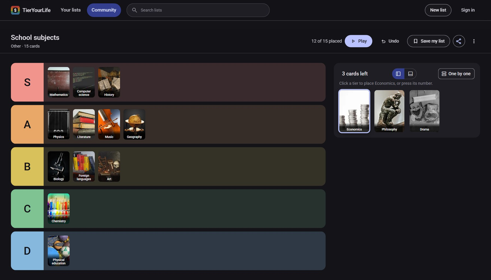
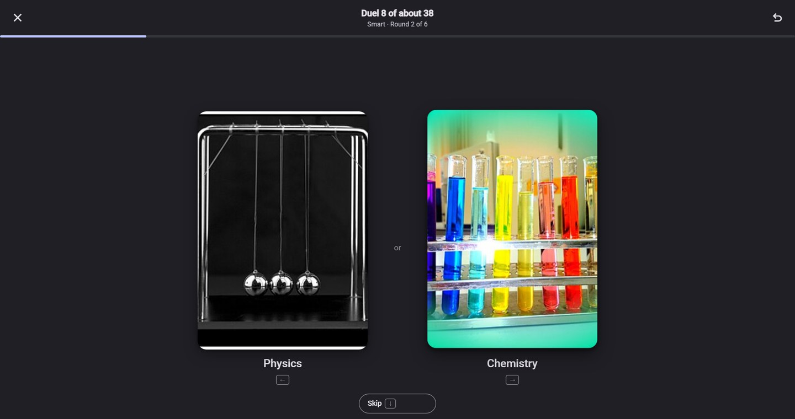
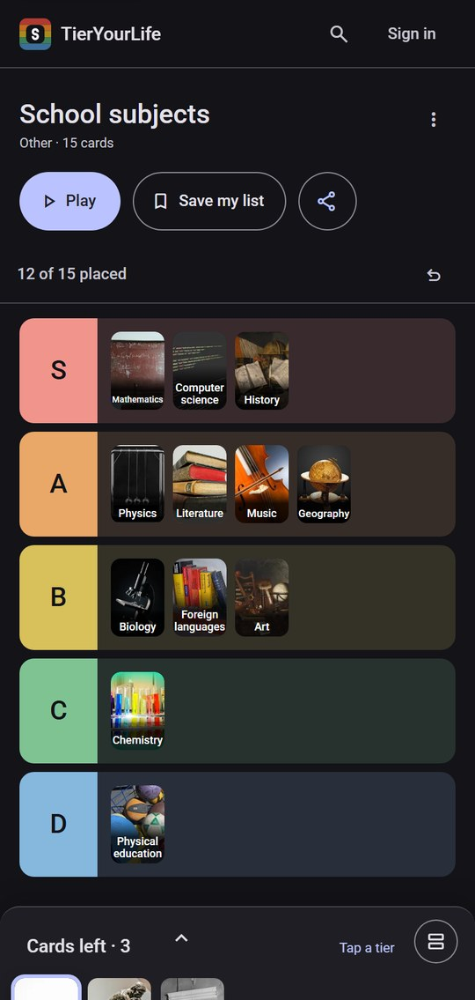
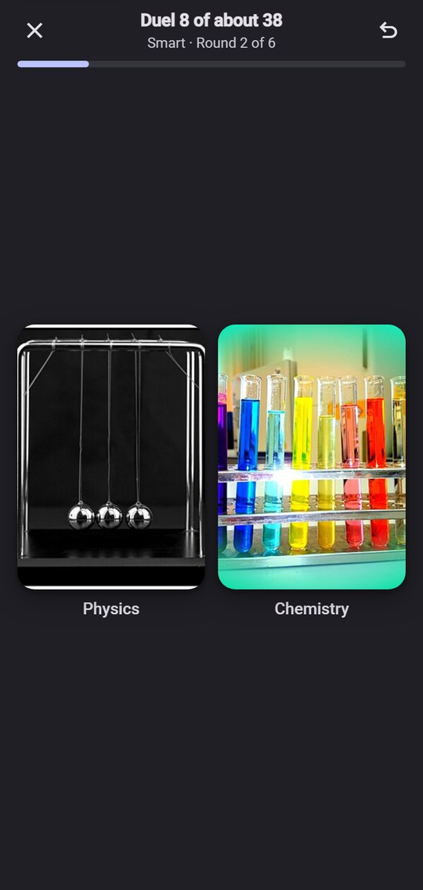

<h1 align="center">TierYourLife: the website</h1>

  <b>Open a list, rank it your way, share the link.</b> 
  The browser version of <a href="https://github.com/kellygracelab-dotcom/TierYourLife">TierYourLife</a>. Free, with no ads, and no account needed to start.

  <a href="https://tieryourlife.com"><b>Open tieryourlife.com</b></a>

  

## What you can do

- **Rank any list.** Drag a card into a tier, click the tier, or press 1 to 5.
- **Duel it out.** Pick the better of two cards and the tiers fill in by themselves. There are four ways to play.
- **Make your own list.** Type a name and get the picture, or paste a link to one.
- **See how others ranked it,** and share your own ranking as a link or a picture.
- **Sign in with Google** and your lists are the same here and in the Android app.

  
  
  

A duel · the same list and the same duel on a phone. The list is <a href="https://tieryourlife.com/l/h9fMXtQMunEyoHvb7qHs">School subjects</a>.

## Three repositories

|                 | Repository                                                                                                              | Where it runs                                |
| --------------- | ----------------------------------------------------------------------------------------------------------------------- | -------------------------------------------- |
| **Website**     | this one: React, TypeScript                                                                                             | [tieryourlife.com](https://tieryourlife.com) |
| **Android app** | [TierYourLife](https://github.com/kellygracelab-dotcom/TierYourLife): Kotlin, Jetpack Compose                           | Google Play, in closed testing               |
| **Server**      | [tieryourlife-proxy](https://github.com/kellygracelab-dotcom/tieryourlife-proxy): Cloud Functions in front of Firestore | behind both                                  |

## For developers

Vite, React 19 and TypeScript, served by Firebase Hosting, with one small Cloud Functions codebase for share pages and rankings.

- [Developing and releasing](DEVELOPMENT.md): the stack, the commands, how a release reaches the public site.
- [The API](https://github.com/kellygracelab-dotcom/tieryourlife-proxy/blob/main/CONTRACT.md) the site and the app both follow.
